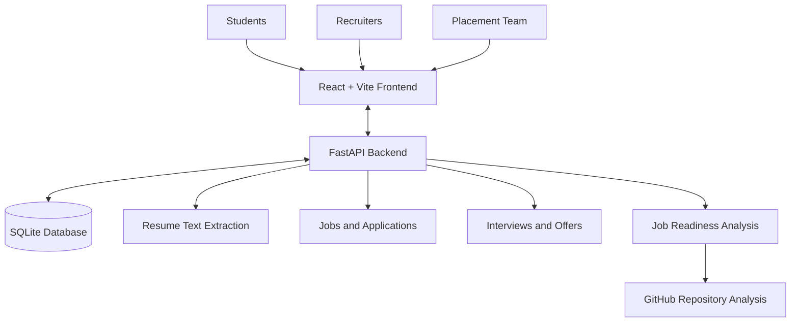

# QuantumCareer Nexus

### AI-Powered Campus Placement Management Platform

QuantumCareer Nexus is a web-based campus placement platform designed to connect students, recruiters, and placement teams through a centralized, automated workflow.

## Key Features

* **Student Profiles:** Manage academic details, skills, projects, and career information.
* **Resume Management:** Upload resumes and extract available information for profile completion.
* **Job Management:** Organize companies, job drives, eligibility criteria, and job openings.
* **Job-Readiness Scoring:** Help recruiters assess candidate skills and placement readiness.
* **GitHub Project Analysis:** Review repository information to support project-skill evaluation.
* **Placement Workflow:** Support applications, interview scheduling, offers, and notifications.
* **Role-Based Dashboards:** Provide different interfaces for students, recruiters, and placement teams.

## Technology Stack

| Technology                    | Purpose                                         |
| ----------------------------- | ----------------------------------------------- |
| React                         | Frontend interface                              |
| Vite                          | Frontend development and build                  |
| CSS                           | Styling and responsive layouts                  |
| Python                        | Backend programming                             |
| FastAPI                       | REST APIs and request handling                  |
| SQLite                        | Database for application records                |
| pypdf and regular expressions | Resume text extraction                          |
| GitHub REST API               | Repository information and analysis integration |

## Architecture




## Project Status

The source code is available in this repository. Deployment, integration, and end-to-end testing are in progress; individual features may require configuration before they work in a live environment.

## Running Locally

**Frontend**

```bash
cd frontend
npm install
npm run dev
```

**Backend**

Create and activate a Python virtual environment, install the packages listed in `backend/requirements.txt`, configure the required environment variables, and start the FastAPI application using the project's entry point.

## Repository

https://github.com/sk-soumya/QuantumCareer-Nexus

**Project:** QuantumCareer Nexus
**Category:** AI and Education Technology
